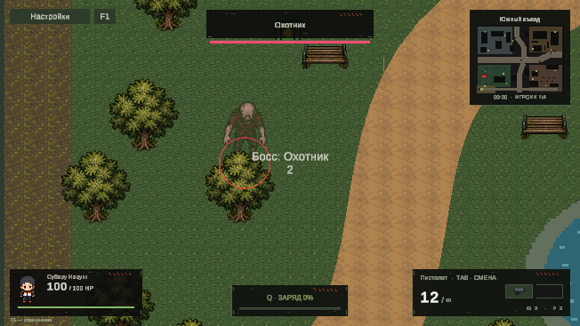

# Boss spawn alert

When an actual boss is created, the existing minimap shows one red diamond with a subtle pulsing halo. It tracks the boss until death, destruction, or removal. An off-map target becomes an arrow inset from the map edge. Player markers, minimap layout, world scale, labels and the existing 0.1-second map refresh cadence remain in use.

The existing `DeadZoneGame.LateUpdate` camera performs a **0.5-second approach, 1-second hold, and 0.5-second return**. It uses smoothstep interpolation to the live boss and player positions, then resumes the existing exponential follow smoothing and aim offset. The camera keeps its current Z, orthographic size, arena clamp and existing combat shake. No second camera controller, virtual camera, coroutine camera writer, input lock, or gameplay-stat changes are introduced.

Simultaneous bosses are introduced in first-in, first-out order; all living bosses retain their markers while another is being introduced. A boss is announced once per match. If the active boss dies or is destroyed, the camera returns from its current position. Dead or removed queued targets are skipped. Player death, a changed spectator target, or a temporarily missing player cancels the current approach/hold into a smooth return. Pausing freezes the introduction timer. Match start, finish, restart and scene teardown clear the registry and queue.

Host spawning calls the notification only after successfully creating the boss and assigning its health. Failed spawn attempts do not notify. Network ghosts reuse the same registry after applying their first living boss snapshot; subsequent snapshots cannot replay an introduction. Ghost health/deletion removes its marker. No network message or protocol changes are needed.

## Modified files and setup

- `Assets/DeadZone/Scripts/DeadZoneGame.cs`: integrates camera output, successful spawning, death and match lifecycle hooks.
- `Assets/DeadZone/Scripts/DeadZoneGame.BossAlerts.cs`: new partial source for the same existing game component; owns the registry, duplicate suppression, queue and camera phases.
- `Assets/DeadZone/Scripts/ZoneEnemy.cs`: unregisters a destroyed boss.
- `Assets/DeadZone/Scripts/ZoneNetwork.cs`: registers living boss ghosts and removes dead/destroyed ones.
- `Assets/DeadZone/Scripts/ZoneMinimap.cs`: draws the red diamond, pulsing halo and edge arrow using the existing mesh and world mapping.
- `Assets/DeadZone/Editor/BossAlertDiagnostics.cs`: repeatable logic and live-player-loop checks.
- `Docs/BOSS_SPAWN_ALERT.md` and `Docs/Images/boss-spawn-alert.png`: documentation and in-game preview.

Unity creates `.meta` files for the two new C# sources. **No Inspector setup is required.** The project continues to use its existing scene references and runtime HUD construction. Open `Assets/Scenes/DeadZoneCityV2.unity` and press Play.

## Validation

In a fresh Play session at the main menu, run **Dead Zone > Check boss spawn alerts**. The test starts its own temporary match, suppresses profile recording, and returns to the menu after completion. Stop Play Mode afterward to discard the diagnostic session.

Verified in Unity 6000.6.0f1 on 2026-10-29:

- `DZ_BOSS_ALERT_LOGIC_PASS`: nearby, distant and boundary-clamped targets; exact approach/hold/return sampling; moving boss and player; no return snap; stable Z and zoom.
- Exactly one rendered marker after repeated notifications, correct world-to-map conversion, off-map edge indication, and removal after a real lethal hit.
- Boss destruction during approach, removed queued targets, FIFO introductions, player death, spectator switch, missing player, respawn and restart.
- Twenty repeated network snapshots produce one marker and one introduction; a dead snapshot removes the marker. A separate two-machine latency test was not run.
- `DZ_BOSS_ALERT_LIVE_PASS`: hold began at **0.50 s**, return at **1.50 s**, normal follow resumed at **2.00 s**. The player loop advanced **413 frames** and fired **8 shots** while the player moved, with input available and health/zoom unchanged.

