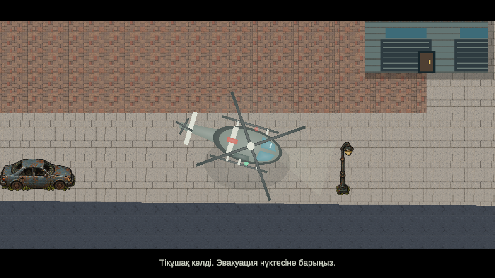
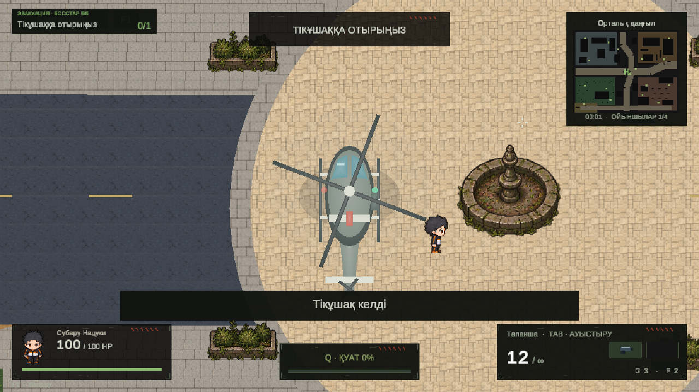

# Five bosses and helicopter evacuation

The mission HUD starts with **Kill five bosses — 0/5**. A registered boss death advances the objective once per wave. After the fifth boss, combat and further spawning stop; victory is deferred until the helicopter leaves with the team.

## Match flow

1. The helicopter appears at the west edge and flies to a clear landing zone near the map centre. A seven-second arrival shot focuses on it, then returns to the player's existing camera. Zoom and camera Z remain unchanged.
2. The HUD changes to **Board the helicopter**. The minimap shows a green **H**, and an off-screen direction indicator points to the landing zone. Downed or dead connected teammates recover so they can reach the extraction point.
3. Each player presses **E** within three world units of the grounded helicopter. The server validates the interaction. Boarding takes priority over nearby loot, hides the seated passenger and their weapon, and disables movement and collision. The HUD shows seated/connected crew; ally cards show **On board**.
4. All connected players must board. Disconnected players do not hold up departure; reconnecting members during takeoff are seated with their existing team. A solo player can depart alone.
5. The camera focuses on takeoff, follows the helicopter, and fades to the victory screen after its 6.5-second departure. Restart clears the boss counter, helicopter, crew flags and camera state.

The existing pause stops the evacuation clock. Arrival and departure block combat input; landing restores control. All objective text is included in the Russian and Kazakh tables. The network protocol is **10**; all participants need this version.

## Editable assets

- `Assets/Resources/Extraction/RescueHelicopter.prefab`: native helicopter hierarchy with separate hull, windows, skids, sliding door, navigation lights, seat indicators and two rotors.
- `Assets/DeadZone/Extraction/HelicopterModel.asset` and `Helicopter.mat`: persistent meshes and unlit vertex-colour material.
- `DeadZoneGame.Extraction.cs`: mission progress, landing selection, phase durations, seating rules, camera and replication.
- `ZoneHelicopterView.cs`: model animation and visual parts. `ZoneObjectiveHud.cs`: objective, subtitles, letterboxing, fade and direction hint.
- `ZoneNetwork.cs`: boss count, flight clock/routes and boarded state in the existing host snapshots.

The runtime prefab is loaded automatically; no scene or Inspector setup is required. The **Dead Zone → Extraction → Prepare helicopter and objective text** command creates missing model assets and updates the existing translation tables. It preserves an existing prefab and does not build a player or Addressables content.

## Verification

In a fresh Play session at the menu, use **Dead Zone → Extraction → Check objective and evacuation**. The check suppresses profile recording and exercises actual boss damage/death, authoritative E commands, idempotency, landing reachability, pause, range/floor/airborne rejection, four passengers, camera focus/return, the real host snapshot and compressed round-trip, late replica/reset, solo departure, disconnect/reconnect and victory after the flight.

The native checks passed in Unity 6000.6.0f1. Two separate computers were not used for this change. No Windows player or Addressables build was made.

