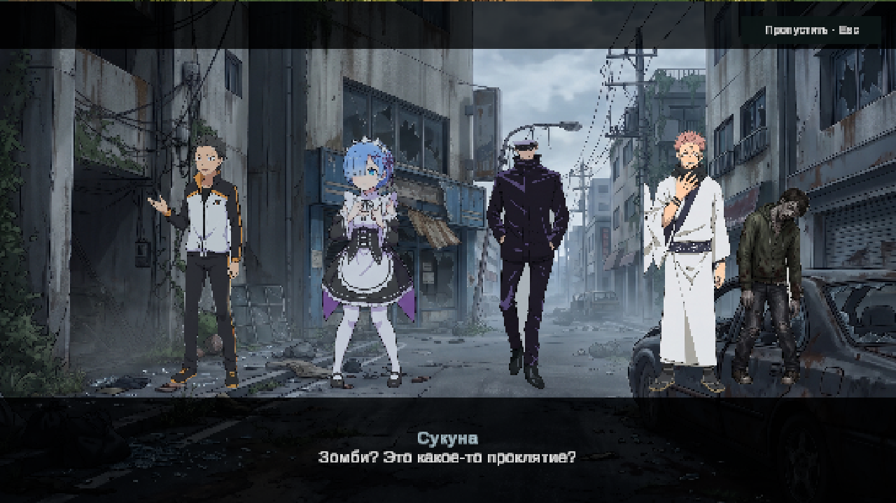
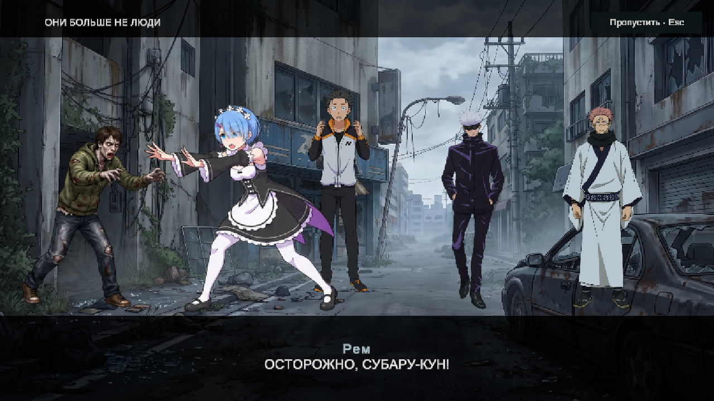

# Вступление

Одиночная игра: Play → «Начать игру». Вступление повторяется при каждой новой игре. Пропуск: кнопка справа сверху или Esc. Длительность полного сценария — около 135 секунд, чтобы сохранить читаемость реплик.

Исходники: `Assets/CutscenePhoto`. Пять новых прозрачных файлов `cutsceneSubaru.png`, `cutsceneRem.png`, `cutsceneGojo.png`, `cutsceneSukuna.png`, `cutsceneZombie.png` добавлены из приложений пользователя и используются вместо JPG персонажей. `IntroArtBuilder.Build()` выделяет 28 поз без соседних фигур в `Assets/DeadZone/Cutscene/Generated` и обновляет `Assets/Resources/Intro/IntroCutscene.asset`. Три фона и исходные JPG сохранены. Белые волосы и тёмная одежда PNG не удаляются как фон. Inspector настраивать не требуется.

Сценарий и длительности: `ZoneIntroScript.cs`. Постановка, субтитры, движение планов, смена поз, толпа и затемнения: `ZoneIntro.cs`. Главное меню вызывает `Begin()`, а первая волна начинается через `StartGameplay()` только после вступления. Выбранный герой сохраняется. Во время вступления мир не запущен, ввод заблокирован. Пропуск и завершение используют один переход с затемнением и очисткой временного Canvas/звуков.

В главе «Они больше не люди» основной зомби подходит слева к Субару. Рем разворачивается к нему, выходит вперёд и отталкивает его; Субару отходит вправо и назад, сохраняя испуганную позу. Годжо и Сукуна стоят справа вне линии столкновения. После защиты порядок по горизонтали: зомби −590, Рем −260, Субару −40, Годжо 260, Сукуна 550. Движение привязано к времени всей фазы и не начинается повторно с каждой репликой.

Ограничения: это постановка из плоских вырезанных персонажей на ваших фонах. Полная озвучка, дыхание и отдельные записи стонов отсутствуют; используются существующие короткие механические/тревожные звуковые акценты. В сетевом матче вступление пока обходится: синхронное вступление для всех участников не реализовано. Непрерывность городской локации условная: после затемнения используется существующая стартовая позиция выбранного героя.

Проверка: `DeadZone.Editor.IntroDiagnostics.Check()` в свежем Play-сеансе. Визуальный пример проверен в игре; полный просмотр в реальном времени отдельно не проводился — окончание проверяется переходом к последней реплике.

Результат: `DZ_INTRO_PASS` — кнопка, запрет двойного запуска, пропуск в начале/середине/конце, завершение, повторный запуск, сохранение героя и первая волна. Итоговая консоль: 0 ошибок, 0 предупреждений. Unity возвращена в Edit Mode.

Обновление PNG и расстановки проверено: 28 подключённых поз, полные фигуры Годжо, направление Рем к зомби и порядок участников на сцене. Повторные проверки `IntroDiagnostics` прошли. Исправленный кадр:

