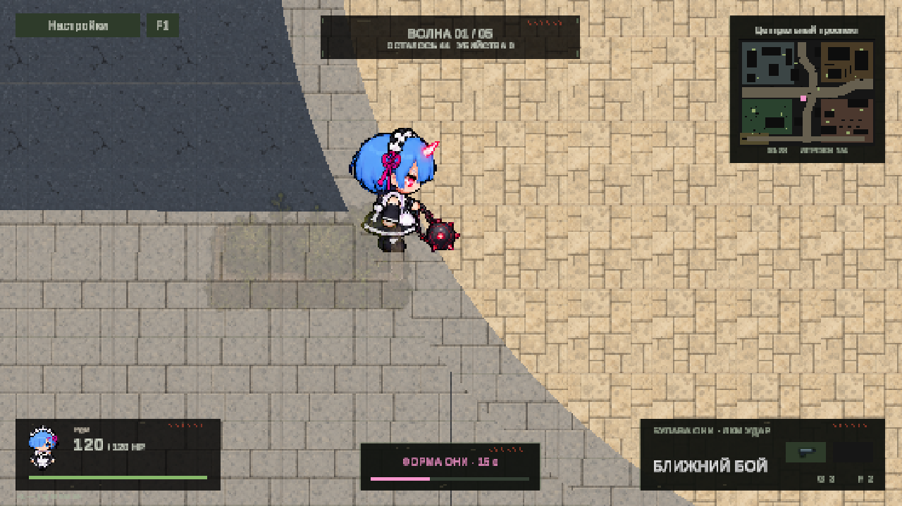

# Rem Oni ultimate animation

Rem's charged **Q** transforms her for 40 seconds. **Left mouse** swings the flail; **WASD** moves; **Left Shift + movement** dashes. The normal character sprites and equipped firearm return when the form ends. Damage, range, cooldowns, wall checks and ammunition behavior retain the existing balance.

Four transparent PNG sheets in `Assets/Resources` contain exactly 80 sprites:

| Sheet | Columns | Directional rows | Frames |
| --- | --- | --- | --- |
| RemOniIdle.png | 4 | Up, Down, Left, Right | 16 |
| RemOniRun.png | 6 | Up, Down, Left, Right | 24 |
| RemOniAttack.png | 6 | Up, Down, Left, Right | 24 |
| RemOniDash.png | 4 | Up, Down, Left, Right | 16 |

Each cell is **192 × 192 pixels**, with a common foot pivot at **(96, 40)** measured from the bottom left, 56 pixels per unit, point filtering, uncompressed color, binary alpha and no mipmaps. Original generated sheets are preserved in `Assets/DeadZone/Art/RemOni/Source`. The importer isolates connected characters and their flails, aligns the feet, and packs uniform cells with transparent padding. It preserves existing sprite identifiers on reimport. Sixteen editable directional `.anim` clips live in the adjacent `Animations` directory.

`ZoneRemArt` drives the in-game sprite selection using the existing character renderer. Dash takes presentation priority and faces movement; attacks face the authoritative swing direction. Attack contact pose 3 starts at the existing 0.22-second hit time. Idle and run loop at 5 and 10 frames per second. The form retains its original geometric presentation if a complete sprite set cannot load.

Optional `dashRemaining` and `dashDirection` fields extend protocol-9 JSON snapshots for peer presentation. Older snapshots default to no dash. Attack timing and direction already travel with the existing Oni state. A live two-player session is still needed to visually inspect the peer animation under latency.

Editor menu actions:

- **Dead Zone / Rem Oni / Import animation sheets** rebuilds the four sheets, slicing metadata and clips from the source images.
- **Dead Zone / Rem Oni / Check animation sheets** checks 80 frames, exact cells and pivots, binary alpha, transparent borders, complete sprites, import settings and clips.
- **Dead Zone / Rem Oni / Check ultimate animation playback**, in Play Mode, checks all directional frames, state transitions, movement-facing dash, snapshot serialization, firearm hiding and base-form restoration.
- **Dead Zone / Check Rem Oni**, in Play Mode, exercises duration, damage, multiple targets, cooldown, ammunition, self-charge, walls, floors and expiry.
- **Dead Zone / Preview Rem Oni**, in Play Mode, sets up a close camera preview. Stop Play Mode after using a diagnostic preview to return to normal scene state.

The new art was generated using the project's existing Rem sprites as reference. Generated animation poses can still benefit from hand-pixel polish; this import and the automatic checks establish technical consistency rather than a claim that every pose is hand-drawn.

Verified in Unity 6000.6.0f1 on 2026-10-28: `DZ_REM_ART_PASS`, `DZ_REM_PLAYBACK_PASS`, and the existing `DZ_REM_PASS` combat checks. The Play session advanced from frame 1836 to 11106, and the captured game view showed `RemOniIdle_3_00` with the Oni timer active. The final Unity console had zero errors and zero warnings. Unity was returned to Edit Mode.
