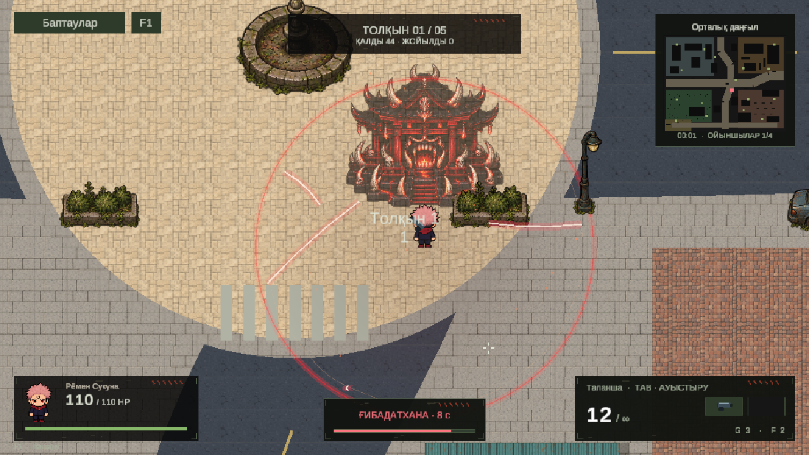
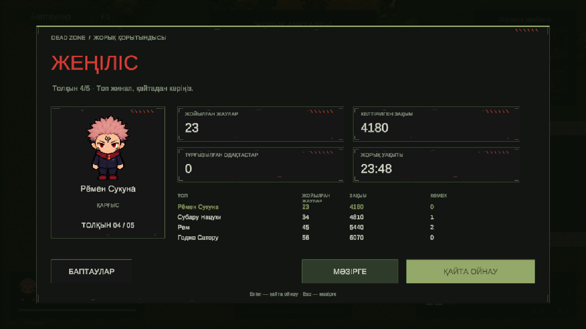

# Dead Zone — обновление 26 октября 2026

Полный редактируемый проект для Unity 6000.6.0f1. Активная сцена — `Assets/Scenes/DeadZoneCityV2.unity`. Исходники, спрайты, материалы, сцены, Unity Localization и настройки входят в репозиторий.

- Карта 112 × 88 с четырьмя кварталами, непрерывными дорогами, новыми объектами окружения и входом команды у края. 16 персональных тайников. Все 31 535 узлов навигации соединены; четыре физических персонажа прошли 24 контрольные точки без застреваний и проникновения в стены.
- Четыре роли врагов: зомби, стрелок, бегун и громила. 92 направленных позы, предупреждения ударов, обход препятствий, дистанция стрелков, разделение толпы, ограничение оглушения пулемётом и исчезающие тела.
- Исправлены смещения физических коллайдеров. Отдельная область попадания по видимому телу; стены блокируют пули, союзники не поглощают дружественные выстрелы.
- Групповой спавн, увеличенные здоровье и урон противников, ограничение количества лута. Длительность 20–30 минут остаётся целью баланса и требует живого прохождения.
- Интерфейс карантинной зоны: заброшенный блокпост, тёмные потёртые панели, приглушённый зелёный, ржавые и красные предупреждения. Новый HUD с двумя слотами оружия, мини-картой, зарядом способности, подсказками и управлением по F1. Русский и казахский, статический шрифт с 190 глифами.
- Новый экран результата с героем, статистикой, таблицей команды и повторным запуском. Наблюдение за живыми союзниками и переключение камеры после смерти; возврат своей камеры при возрождении.
- У Сукуны — появление святилища, светящаяся фаза, алые разрезы, искры, разрушение и затухание. Боевые параметры сохранены: подготовка 0,8 с, работа 8 с, радиус 5,2 м, 40 урона каждые 0,65 с. Стены и этажи учитываются, собственный урон не заряжает способность.
- Сетевой протокол 9: ограниченные по размеру сжатые снимки мира, состояния анимаций, тел, тайников и оружейных слотов. Всем участникам нужна одна версия.

В Unity проверены маршрут четырёх персонажей, области попадания и укрытия, поведение врагов, ограничения оглушения, персональные тайники, сжатие большого снимка мира, параметры Сукуны, сброс матча и камера наблюдателя. Меню и результат просмотрены в Play Mode на русском и казахском.

По просьбе пользователя расширенные проверки сокращены: текущий протокол 9 не проходил новый полный сетевой прогон, все соотношения сторон и полный баланс пяти волн не подтверждены. Ранее проверялся локальный кооператив из четырёх процессов для протокола 8. Интернет-коды требуют привязки собственного Unity Cloud project; независимые интернет-соединения не проверены.

Сцена и окружение редактируются обычными инструментами Unity. Цвета и компоновка интерфейса находятся в `ZonePalette.cs`, `DeadZoneGame.cs`, `ZoneCombatHud.cs`, `ZoneResultsPanel.cs`; святилище — в `ZoneShrineView.cs`. Пересоздание карты через меню Rework перезаписывает сцену: для своих изменений используйте Save As.

Сборка Windows после обновления: **Succeeded, 0 errors** (Unity 6000.6.0f1, Development/Mono). Новый полный импорт из чистого клона не повторялся по просьбе сократить проверки.

