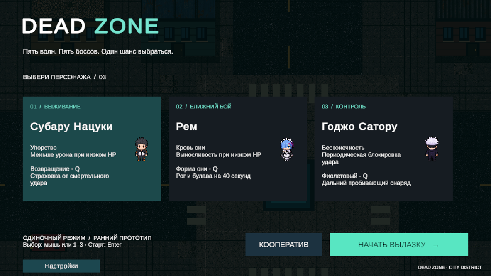

# Dead Zone — Unity project

Редактируемые исходники 2D top-down шутера для Windows: одиночная игра и кооператив, пять волн с боссами, Subaru, Rem и Gojo.

## Открыть в Unity

1. Склонируйте репозиторий или скачайте Code → Download ZIP и распакуйте архив.
2. Установите **Unity 6000.6.0f1** через Unity Hub с Windows Build Support (Mono).
3. В Unity Hub выберите **Add → Add project from disk** и папку с `Assets`, `Packages`, `ProjectSettings`.
4. Дождитесь импорта пакетов, откройте `Assets/Scenes/DeadZoneCity.unity`, нажмите Play.

При первом открытии нужен интернет для Package Manager. Library и готовый Windows player исключены из Git; прежняя бинарная версия остаётся в истории.

На Windows выбирайте короткий путь, например `C:\Projects\dead-zone`: длинные вложенные пути могут мешать импорту файлов Unity-пакетов.

## Управление

| Действие | Клавиша |
| --- | --- |
| Движение / прицел / огонь | WASD / мышь / ЛКМ |
| Рывок / способность | Left Shift / Q |
| Перезарядка / смена оружия | R / Tab |
| Поднять предмет или союзника | E |
| Граната / мина | G / F |
| Меню | Esc |

Пистолет имеет бесконечный резерв с перезарядкой. Есть автомат, пулемёт и дробовик. Рем получает рог и булаву на 40 секунд: ЛКМ выполняет удары. Годжо запускает заряжающийся фиолетовый снаряд.

## Редактирование и сборка

- Карта: Tilemap и GameObject в `Assets/Scenes/DeadZoneCity.unity`.
- Арт карты: `Assets/DeadZone/CityArt`. Меню `Dead Zone/Rebuild arena (owned art)` пересоздаёт сцену: сначала сохраните свою карту под другим именем.
- Баланс: `Assets/Resources/DeadZoneBalance.asset` через Inspector.
- Оружие: `Assets/DeadZone/Scripts/ZoneArsenal.cs`.
- Герои: `Assets/DeadZone/Content`; игровой код: `Assets/DeadZone/Scripts`.
- Сборка: меню `Dead Zone/Build polished Windows game`, результат `Builds/Quality/DeadZone.exe`.

## Сеть

LAN: создайте комнату и подключитесь по IP ведущего. Всем нужна одна версия, протокол **7**. Для входа по интернет-коду привяжите собственный Unity Cloud project и настройте Unity Multiplayer Services в Dashboard. Приватные ключи в Git не включены. Выход ведущего завершает матч.

## Состояние

Новая одноэтажная городская арена, постепенный спавн, пять вариантов поведения боссов, настройки громкости и тряски, боевой HUD. Проверки и ограничения: [Docs/QUALITY_REPORT.md](Docs/QUALITY_REPORT.md).

Доступны три героя. Четвёртый, полный перевод на казахский и окончательный баланс прохождения остаются дальнейшими задачами. Сторонние карты Cainos/LoBit City исключены из публичного проекта, активная сцена использует заменяющие материалы. [CREDITS.md](CREDITS.md).
